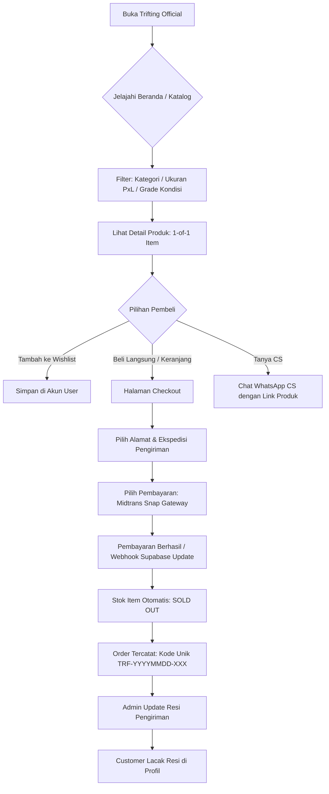

# PRODUCT REQUIREMENT DOCUMENT (PRD)
# Projek: Trifting Official — Modern Thrift & Streetwear E-Commerce

================================================================================
ZONA ATAS: SPESIFIKASI KEBUTUHAN PRODUK (BLUEPRINT AWAL)
================================================================================

## 1. Problem Statement & Visi Produk
- **Masalah:** Bisnis thrifting dan fashion preloved kurasi streetwear seringkali hanya berjualan di media sosial (Instagram/TikTok/WhatsApp) yang rawan rebutan pesanan ("drop war"), pencatatan manual yang rentan salah stok, kesulitan pelacakan resi, serta verifikasi pembayaran yang memakan waktu.
- **Solusi:** "Trifting Official" — sebuah website e-commerce modern, stylish, berestetika streetwear premium ala Human-Crafted (Anti-AI), minimalis dan mobile-first. Menghubungkan pembeli thrift dengan sistem belanja instan, fitur drop timer, kalkulasi ongkir ekspedisi otomatis, payment gateway terintegrasi, dan dashboard admin terpadu untuk mengelola inventaris unik "One-of-a-Kind" (1 pcs per item).

---

## 2. Peran Pengguna (User Roles)
1. **Tamu (Guest / Unauthenticated Customer):**
   - Menjelajahi beranda, banner drop rilis, kategori, dan katalog produk kurasi.
   - Menggunakan pencarian instan dan multi-filter (kategori, ukuran, kondisi, rentang harga).
   - Melihat detail produk lengkap (foto beresolusi tinggi, detail minus/defect, ukuran riil P x L dalam cm, grade kondisi).
   - Menambahkan item ke keranjang dan melakukan simulasi checkout.
   - Menghubungi Customer Service via WhatsApp Button yang responsif.
2. **Pelanggan Terdaftar (Customer):**
   - Registrasi & Login aman via Supabase Authentication (Email/Password & Magic Link).
   - Mengelola Wishlist personal (item favorit tersimpan di akun).
   - Checkout pesanan dengan integrasi alamat lengkap (Provinsi, Kota/Kabupaten, Kecamatan) dan kalkulasi ongkir ekspedisi real-time (JNE, SiCepat, J&T).
   - Pembayaran otomatis instan via Payment Gateway (Midtrans Snap: QRIS, GoPay, ShopeePay, Virtual Account BCA/Mandiri/BRI/BNI, Kartu Kredit).
   - Melacak riwayat pesanan (Order History), status proses, nomor resi pengiriman, serta cetak bukti nota/invoice.
3. **Super Admin (Store Owner / Admin Toko):**
   - Akses aman ke Dashboard Admin (dilindungi Supabase RLS & Role Verification).
   - Memantau metrik performa penjualan secara real-time (Gross Revenue, Total Order, Produk Terjual, Tingkat Konversi, Status Pengiriman).
   - CRUD Produk Thrift (Nama, Slug, Kategori, Brand, Ukuran Riil PxL, Grade Kondisi A/B/C, Deskripsi, Foto Produk multi-upload ke Supabase Storage, Harga Jual, Harga Asli/Coret, Status: Available / Reserved / Sold Out).
   - Manajemen Kategori & Promo Voucher (Kode diskon, persentase/potongan nominal, kuota voucher, masa berlaku).
   - Manajemen Pesanan & Logistik (Update status order: Pending, Paid, Processing, Shipped, Delivered, Cancelled; input nomor resi pengiriman, generate cetak Label Alamat & Invoice Packing).
   - Laporan Penjualan (Filter periode harian, mingguan, bulanan, ekspor data rekapitulasi).

---

## 3. Arsitektur & Lingkungan Kerja
- **Frontend & Fullstack Framework:** Next.js (App Router, React 19 / 18, TypeScript) dengan arsitektur Server Components & Client Components modular.
- **Styling & UI:** Tailwind CSS v3/v4, Lucide React Icons (SVG murni, anti-emoticon norak), Framer Motion untuk transisi halus streetwear (micro-interactions).
- **Desain & Palet Warna (Sesuai Logo & Referensi Desain SOLEX):**
  - Primary Background: Warm Off-White / Cream (`#FAF9F5` / `#F5F5F0`) & Deep Dark Streetwear Black (`#0F1012` / `#161719`).
  - Text & Accent: Deep Jet Black (`#111111`), Muted Streetwear Olive Green (`#3A4D28` - senada aksen daun logo Trifting Official), Neutral Zinc/Slate Muted Grey (`#71717A` / `#27272A`).
  - Visual Aesthetics: Tipografi modern sans-serif tegas berbobot tinggi, kartu produk bersih dengan shadow lembut, radius halus (rounded-md / rounded-lg), layout mobile-friendly dengan sticky bottom navigation bar di HP.
- **Backend & Database:** Supabase Postgres Database, Supabase Auth, Supabase Storage (bucket `product-images`), Row Level Security (RLS) aktif dengan pemisahan policy ketat antara Admin dan Customer.
- **Payment Gateway:** Midtrans Snap (Sandbox & Production Ready: Snap token generation via Next.js API Route Server-Side, webhook notification handler aman dengan validasi SHA512 signature).
- **Shipping Logistics:** Integrasi modul kalkulator ekspedisi (RajaOngkir / Biteship ready provider service) dengan fallback flat-zone rate jika offline/kuota habis.
- **Hosting & Deployment:** Vercel (Production CI/CD otomatis terhubung ke Git & Supabase).

---

## 4. Alur Kerja Aplikasi (User Flow)

---

## 5. Desain Basis Data (Database Schema)
*Catatan Standar ZettBOT: Nama tabel menggunakan PascalCase/camelCase tanpa karakter underscore (`_`).*

### Tabel 1: `profiles`
Menyimpan data identitas pengguna dan peran (Role).
- `id` (UUID, Primary Key, Relasi ke `auth.users.id`, ON DELETE CASCADE)
- `email` (TEXT, Not Null)
- `fullName` (TEXT)
- `phoneNumber` (TEXT)
- `role` (TEXT, Default 'customer', Nilai: 'customer' | 'admin')
- `avatarUrl` (TEXT)
- `defaultAddress` (JSONB: {provinsi, kota, kecamatan, kodepos, detailAlamat})
- `createdAt` (TIMESTAMPTZ, Default NOW())
- `updatedAt` (TIMESTAMPTZ, Default NOW())

### Tabel 2: `categories`
Kategori pakaian streetwear/thrift.
- `id` (UUID, Primary Key, Default gen_random_uuid())
- `name` (TEXT, Not Null, e.g. "Vintage T-Shirt", "Workwear & Jackets", "Hoodies & Crewnecks", "Denim & Pants", "Caps & Accessories")
- `slug` (TEXT, Unique, Not Null)
- `description` (TEXT)
- `imageUrl` (TEXT)
- `createdAt` (TIMESTAMPTZ, Default NOW())

### Tabel 3: `products`
Katalog item thrift satu-satunya (One-of-a-Kind).
- `id` (UUID, Primary Key, Default gen_random_uuid())
- `title` (TEXT, Not Null)
- `slug` (TEXT, Unique, Not Null)
- `categoryId` (UUID, Foreign Key ke `categories.id`)
- `brand` (TEXT, e.g. "Carhartt", "Nike Vintage", "Stussy", "Harley Davidson")
- `size` (TEXT, e.g. "L (P 72cm x L 56cm)", "XL fit to L")
- `conditionGrade` (TEXT, e.g. "Grade A+ (Like New)", "Grade A (9.5/10)", "Grade B (Minus Noda Samar)", "Vintage Distressed")
- `conditionNotes` (TEXT, deskripsi minus/defect jika ada)
- `price` (NUMERIC, Not Null, e.g. 185000)
- `originalPrice` (NUMERIC, opsional harga coret/retail)
- `images` (TEXT[], array URL foto dari Supabase Storage)
- `description` (TEXT)
- `status` (TEXT, Default 'available', Nilai: 'available' | 'reserved' | 'sold')
- `isFeatured` (BOOLEAN, Default false)
- `createdAt` (TIMESTAMPTZ, Default NOW())
- `updatedAt` (TIMESTAMPTZ, Default NOW())

### Tabel 4: `promotions`
Kupon promo dan voucher diskon.
- `id` (UUID, Primary Key, Default gen_random_uuid())
- `code` (TEXT, Unique, Not Null, e.g. "TRIFTWAR10")
- `discountType` (TEXT, Nilai: 'percentage' | 'fixed')
- `discountValue` (NUMERIC, Not Null)
- `minSpend` (NUMERIC, Default 0)
- `maxDiscount` (NUMERIC)
- `usageLimit` (INTEGER)
- `usedCount` (INTEGER, Default 0)
- `expiresAt` (TIMESTAMPTZ)
- `isActive` (BOOLEAN, Default true)

### Tabel 5: `orders`
Transaksi pesanan dengan nomor kode sekuensial anti-tabrakan.
- `id` (UUID, Primary Key, Default gen_random_uuid())
- `orderNumber` (TEXT, Unique, Not Null, Format: `TRF-YYYYMMDD-XXX`)
- `userId` (UUID, Foreign Key ke `profiles.id`, Nullable jika guest checkout)
- `customerName` (TEXT, Not Null)
- `customerEmail` (TEXT, Not Null)
- `customerPhone` (TEXT, Not Null)
- `shippingAddress` (JSONB, Not Null: {recipient, phone, street, district, city, province, postalCode})
- `shippingCourier` (TEXT, e.g. "JNE Regular", "SiCepat BEST", "J&T Express")
- `shippingCost` (NUMERIC, Not Null, Default 0)
- `subtotal` (NUMERIC, Not Null)
- `discountAmount` (NUMERIC, Default 0)
- `totalAmount` (NUMERIC, Not Null)
- `paymentStatus` (TEXT, Default 'pending', Nilai: 'pending' | 'paid' | 'failed' | 'expired')
- `orderStatus` (TEXT, Default 'processing', Nilai: 'pending' | 'processing' | 'shipped' | 'delivered' | 'cancelled')
- `paymentMethod` (TEXT, e.g. "Midtrans QRIS", "BCA Virtual Account", "Manual Transfer")
- `paymentRef` (TEXT, Midtrans Transaction ID / Reference)
- `trackingNumber` (TEXT, Nomor Resi Pengiriman)
- `notes` (TEXT)
- `createdAt` (TIMESTAMPTZ, Default NOW())
- `updatedAt` (TIMESTAMPTZ, Default NOW())

### Tabel 6: `orderitems`
Detail produk dalam pesanan.
- `id` (UUID, Primary Key, Default gen_random_uuid())
- `orderId` (UUID, Foreign Key ke `orders.id`, ON DELETE CASCADE)
- `productId` (UUID, Foreign Key ke `products.id`)
- `productTitle` (TEXT, Not Null)
- `productPrice` (NUMERIC, Not Null)
- `productSize` (TEXT)
- `productImage` (TEXT)

### Tabel 7: `wishlists`
Daftar produk incaran pelanggan.
- `id` (UUID, Primary Key, Default gen_random_uuid())
- `userId` (UUID, Foreign Key ke `profiles.id`, ON DELETE CASCADE)
- `productId` (UUID, Foreign Key ke `products.id`, ON DELETE CASCADE)
- `createdAt` (TIMESTAMPTZ, Default NOW())

---

## 6. Aturan Validasi & Logika Bisnis Khusus (Business Logic)
1. **Aturan Stok Thrift 'One-of-a-Kind' (Anti-Double Booking):**
   - Setiap item thrift hanya memiliki 1 unit fisik.
   - Ketika proses checkout dimulai dan menuju pembayaran, item berstatus `reserved` (maksimal 15 menit). Jika pembayaran berhasil, status berubah menjadi `sold`. Jika gagal/expired, status otomatis kembali ke `available`.
2. **Penomoran Kode Transaksi Otomatis:**
   - Format: `TRF-YYYYMMDD-XXX` (contoh: `TRF-20261121-001`, `TRF-20261121-002`).
   - Dihitung di level database/backend menggunakan angka sekuensial tertinggi pada hari berjalan untuk menjamin urutan konsisten tanpa benturan multi-user.
3. **Keamanan Kredensial & Supabase RLS:**
   - Secret key (Supabase Service Role Key & Midtrans Server Key) hanya berjalan di Server-Side API Route (`/api/checkout`, `/api/midtrans/notification`, `/api/admin/*`).
   - Client frontend hanya mengakses `NEXT_PUBLIC_SUPABASE_URL` dan `NEXT_PUBLIC_SUPABASE_ANON_KEY`.
   - RLS Policy:
     - Publik: READ produk berstatus `available` dan `sold`.
     - Customer: READ & WRITE pesanan, wishlist, dan profil milik `auth.uid()` sendiri.
     - Admin: Full CRUD seluruh tabel berlandaskan verifikasi `profiles.role = 'admin'`.

---

## 7. Rencana Antarmuka Pengguna (UI/UX Plan)
1. **Header & Navigation Bar:**
   - Logo Trifting Official (vektor/SVG & logo grafis TF).
   - Menu Navigasi: Home, Katalog, Kategori, Drop Release, Tentang Kami.
   - Action Bar: Search modal instan, Wishlist badge count, Keranjang belanja badge count, Akun/Login dropdown.
   - Mobile: Clean floating/bottom navigation bar yang ergonomis bagi jempol.
2. **Beranda (Homepage - Streetwear Premium Style ala SOLEX Reference):**
   - Hero Section: Headline bold "Curated Vintage & Streetwear Grails", visual hero aesthetic, CTA "Belanja Sekarang" & "Lihat Drop Terbaru".
   - Thrift Drop Countdown Timer ("Next Drop in: 02h 45m 12s").
   - Brand Marquee / Row (Nike, Carhartt, Stussy, Adidas, Polo, Harley Davidson).
   - Shop by Category Cards: Visual thumbnail minimalis dengan hover elevate.
   - Best Sellers & New Arrivals Grid (2 kolom di mobile, 4 kolom di desktop) dengan badge kondisi (e.g. `GRADE A+`), tombol wishlist interaktif, dan penanda `SOLD OUT` jika terjual.
   - Promotional Banner ("Vintage Drop Sale Up to 40% OFF").
   - Trust Badges: 100% Authentic Curated, Washed & Ready-to-Wear, Fast Shipping, Safe Guarantee.
   - Footer: Dark minimalist dengan link navigasi, link WhatsApp CS, dan copyright resmi.
3. **Halaman Katalog & Detail Produk:**
   - Filter Sidebar (Desktop) & Filter Drawer (Mobile): Search query, Kategori, Rentang Harga slider, Ukuran (S, M, L, XL, XXL), Grade Kondisi.
   - Detail Produk: Galeri multi-foto dengan zoom, detail spesifikasi riil (Panjang x Lebar dalam cm, tag leher, kondisi minus secara transparan), tombol "Beli Sekarang", tombol "Tambah ke Keranjang", dan tombol "Tanya CS via WhatsApp" yang otomatis menyertakan nama dan link produk.
4. **Keranjang & Checkout:**
   - Ringkasan item belanja.
   - Form data pengiriman lengkap (Provinsi, Kota, Kecamatan).
   - Pilihan kurir dan kalkulasi ongkir otomatis.
   - Input voucher diskon.
   - Tombol "Bayar Sekarang" yang memunculkan pop-up Midtrans Snap Gateway.
5. **Customer Portal:**
   - Profil Pengguna & Alamat Tersimpan.
   - Riwayat Pesanan dengan filter status (Pending, Diproses, Dikirim, Selesai).
   - Detail Resi Pengiriman dan pelacakan.
   - Halaman Wishlist dengan opsi "Pindahkan ke Keranjang".
6. **Admin Dashboard:**
   - Dashboard Overview: Grid metrik 3 kolom (Total Pendapatan, Pesanan Aktif, Produk Terjual), grafik tren penjualan, daftar transaksi terbaru.
   - Modul Produk: Tabel produk responsif fluid, filter status, form tambah/edit produk dengan drag-and-drop foto multi-upload langsung ke Supabase Storage, auto-slug generator, dan kalkulator harga.
   - Modul Pesanan: Tabel order lengkap, filter status pembayaran, modal update resi pengiriman, tombol cetak Invoice & Label Pengiriman (Thermal / PDF ready).
   - Modul Kategori & Promo: Manajemen kode voucher diskon.
   - Modul Laporan Penjualan: Rekapitulasi penjualan dengan opsi unduh/export.

---

## 8. Kriteria Pengujian (Acceptance Criteria)
- [ ] Pengguna dapat menjelajahi beranda dan katalog tanpa kendala di layar HP maupun Desktop.
- [ ] Fitur pencarian, filter kategori, ukuran, harga, dan kondisi bekerja akurat dan cepat.
- [ ] Sistem otentikasi Supabase (Register, Login, Logout, Profile Update) berfungsi 100%.
- [ ] Transaksi checkout berhasil mengkalkulasi subtotal + ongkir - voucher secara presisi.
- [ ] Midtrans Snap Gateway dapat menerima pembayaran sandbox (QRIS, VA) dan status pesanan otomatis ter-update via callback.
- [ ] Produk yang sudah terbeli otomatis berstatus `sold` dan tidak bisa di-checkout ulang oleh pembeli lain.
- [ ] Admin dapat login, menambah produk baru beserta foto ke Supabase Storage, mengubah harga/stok, dan meng-update nomor resi.
- [ ] Kode terbebas dari syntax error, responsif, dan siap dideploy ke Vercel dengan konfigurasi env aman.

================================================================================
ZONA BAWAH: MASTER CONTEXT & LOGIKA SISTEM TERKINI (LIVING CONTEXT)
================================================================================

- **Status Arsitektur Aktif:** Next.js 14 (App Router, TypeScript) + Tailwind CSS + Supabase (Auth, Postgres, Storage) + Midtrans Snap Gateway + Vercel Production Ready.
- **Daftar Rute Halaman Aktif:**
  - `/` : Beranda modern streetwear (Hero Banner ala SOLEX, Drop Day Countdown, Brand Bar, Curated Highlights, Shop by Category, Promo 40% OFF Banner, Value Proposition).
  - `/catalog` : Katalog pakaian thrift dengan pencarian teks real-time, filter kategori dinamis, ukuran pakaian, grading kondisi, slider harga, dan pengurutan harga.
  - `/drop` : Vault khusus rilis Drop Day (jadwal drop Sabtu 19:00 WIB, live countdown timer, aturan rebutan 1-of-1, dan katalog drop grails).
  - `/product/[slug]` : Detail produk thrift (Galeri foto multi-angle, pengukuran P x L centimeter riil, grading kondisi, stok 1-of-1, add to cart / quick buy, tombol WhatsApp CS otomatis).
  - `/checkout` : Formulir pengiriman Indonesia lengkap, kurir ekspedisi (JNE, SiCepat, J&T), kalkulasi ongkir, kupon voucher, integrasi pembayaran Midtrans Snap, nomor order sekuensial `TRF-YYYYMMDD-XXX`.
  - `/orders/[id]` : Invoice resmi & pelacakan nomor resi pengiriman, timeline status pesanan, dan cetak invoice.
  - `/orders/my-orders` : Portal riwayat belanja pelanggan.
  - `/wishlist` : Vault produk incaran pribadi pelanggan.
  - `/login` & `/register` : Otentikasi khusus pelanggan/customer (bersih tanpa tombol demo admin).
  - `/admin/login` : Gerbang login terisolasi khusus Super Admin (kredensial & verifikasi admin).
  - `/admin` : Dashboard metrik penjualan 3-kolom (dilindungi Route Guard 403).
  - `/admin/products` : Manajemen CRUD inventaris pakaian thrift (tambah produk, upload foto, ukuran PxL, grade, toggle status).
  - `/admin/orders` : Kelola pesanan, ubah status order, input resi ekspedisi, dan cetak Label Pengiriman Thermal.
  - `/admin/promos` : Kelola voucher diskon kampanye promo drop.
  - `/admin/reports` : Laporan analitik keuangan dan ekspor file CSV.
- **Skema Database Berjalan:** SQL Schema Postgres di `supabase/schema.sql` (7 tabel: `profiles`, `categories`, `products`, `promotions`, `orders`, `orderitems`, `wishlists`, triggers auth & RLS policies).
- **Log Pembaruan Resmi:**
  - v1.0.0: Pembangunan arsitektur lengkap toko dan dashboard admin.
  - v1.0.1: Security Hardening (Penguncian portal admin dengan Route Guard 403, gerbang `/admin/login`, pembersihan tombol demo admin publik, dan isolasi link internal dari footer/navbar).
  - v1.0.2: Mobile Responsive Polish (Perbaikan laci keranjang belanja `CartDrawer.tsx` agar pas di layar ponsel tanpa celah samping dan tanpa teks/tombol terpotong).
  - v1.0.3: Relational Transaction Architecture & Supabase Sync (Perbaikan struktur transaksi pesanan: penggunaan ID berstandar UUID v4, pemisahan rincian produk ke tabel `orderitems`, relasi guest checkout aman, serta perbaruan RLS policies untuk pembacaan real-time di Dashboard Admin).
  - v1.0.4: Master Admin Security Hardening (Penguncian mutlak portal admin via API Server-Side `/api/admin/login` dengan fixed master credentials yang tervalidasi ketat dan anti-bypass).
  - v1.0.5: Direct Photo Upload & Auto-Resolver (Fitur upload foto langsung dari galeri HP/laptop ke Supabase Storage `product-images`, thumbnail preview instan, auto-resolve nama file, dan pengaman relasi `categoryId` UUID).
  - v1.0.6: Dual-Sync Product Merging & Safe Catalog Filtering (Algoritma penggabungan data produk cloud Supabase dan lokal admin secara permanen agar produk baru tidak pernah tertimpa atau hilang saat navigasi ke katalog, serta proteksi null-safe pada pencarian kata kunci).
